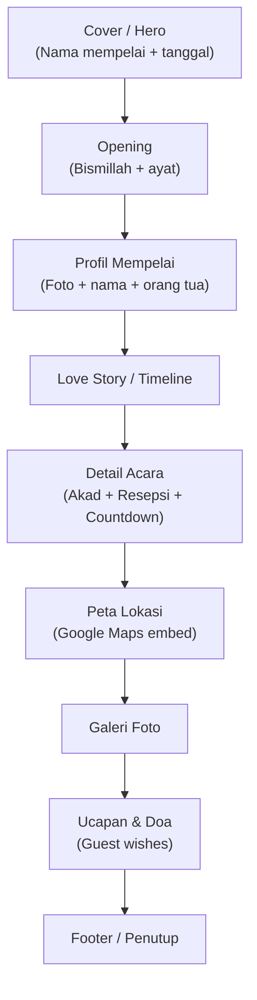

# PRD — Undangan Digital Pernikahan

## 1. Overview

Aplikasi undangan pernikahan digital berbasis web, ringan di semua perangkat (mobile-first), tanpa framework — murni HTML/CSS/JS. Tema visual **Sage Green & Gold**.

> [!IMPORTANT]
> Target utama: performa ringan di HP low-end sekalipun. Tidak boleh ada framework berat, build tool, atau dependency eksternal yang memperlambat load.

---

## 2. Target User

| User | Deskripsi |
|------|-----------|
| **Mempelai** | Pemilik undangan, bisa edit data (manual via code) |
| **Tamu** | Penerima undangan, buka via link, bisa RSVP & kirim ucapan |

---

## 3. Tech Stack

| Layer | Teknologi |
|-------|-----------|
| Markup | HTML5 semantic |
| Styling | CSS3 (custom properties, flexbox, grid) |
| Interaktif | Vanilla JavaScript (ES6+) |
| Font | Google Fonts (CDN) |
| Icon | Inline SVG / CSS-only |
| Hosting | GitHub Pages (gratis) |
| Peta | Google Maps embed (iframe) |
| Musik | HTML5 `<audio>` API |

> [!NOTE]
> Tidak ada build tool, bundler, atau npm. Semua file statis, langsung deploy ke GitHub Pages.

---

## 4. Struktur Halaman (Single Page — Scroll)



---

## 5. Detail Fitur

### 5.1 Cover / Hero
- Fullscreen, background image/pattern
- Nama mempelai (typography besar, elegant)
- Tanggal acara
- Tombol **"Buka Undangan"** — trigger musik & scroll ke konten
- Nama tamu dari URL parameter (`?to=Nama+Tamu`)

### 5.2 Opening
- Bismillah / ayat Al-Quran tentang pernikahan (Ar-Rum:21)
- Animasi fade-in saat scroll

### 5.3 Profil Mempelai
- Foto mempelai pria & wanita (placeholder circle)
- Nama lengkap
- Nama orang tua (putra/putri dari Bapak ... & Ibu ...)
- Urutan anak (opsional)

### 5.4 Love Story / Timeline
- Timeline vertikal (mobile-friendly)
- 3-5 milestone dengan ikon, tanggal, deskripsi singkat
- Animasi scroll reveal

### 5.5 Detail Acara
- **Akad Nikah**: tanggal, jam, lokasi
- **Resepsi**: tanggal, jam, lokasi
- **Countdown timer**: hitung mundur ke hari-H (JS)
- Card-based layout

### 5.6 Peta Lokasi
- Google Maps iframe embed
- Tombol "Buka di Google Maps" (deep link)
- Alamat lengkap text

### 5.7 Galeri Foto
- Grid layout responsive (2 kolom mobile, 3-4 kolom desktop)
- Lightbox on click (JS murni, tanpa library)
- Placeholder images (6-8 slot)

### 5.8 Musik Latar
- Autoplay setelah klik "Buka Undangan"
- Toggle play/pause (floating button)
- File audio lokal (MP3)
- Placeholder: royalty-free instrumental

### 5.9 Ucapan & Doa (Guest Wishes)
- Form: nama + ucapan
- Tampil sebagai list/card setelah submit
- **Storage**: `localStorage` (offline-only, no backend)
- Bisa upgrade ke backend (API/Firebase) nanti

> [!TIP]
> `localStorage` cukup buat demo/preview. Untuk produksi dengan banyak tamu, upgrade ke Firebase Realtime DB atau simple API — `ponytail:` deliberate cut, upgrade path jelas.

### 5.10 Footer
- Terima kasih
- Credit / watermark (opsional)

---

## 6. Design System

### Warna (Sage Green & Gold)

| Token | Hex | Penggunaan |
|-------|-----|------------|
| `--primary` | `#87A878` | Background section, border |
| `--primary-dark` | `#6B8F5E` | Hover, heading |
| `--accent` | `#C9A84C` | Highlight, tombol, ornamen |
| `--accent-light` | `#E8D5A3` | Border, subtle detail |
| `--bg-light` | `#F9F7F2` | Background utama |
| `--bg-white` | `#FFFFFF` | Card background |
| `--text-dark` | `#2C3E2D` | Body text |
| `--text-muted` | `#6B7B6C` | Secondary text |

### Typography
- **Heading**: Serif (Playfair Display / Cormorant Garamond)
- **Body**: Sans-serif (Poppins / Lato)
- **Accent/Script**: Cursive (Great Vibes — nama mempelai)

### Animasi
- Scroll reveal (fade-up) — CSS `@keyframes` + IntersectionObserver
- Smooth scroll antar section
- Transisi halus, tidak berlebihan

---

## 7. Struktur File

```
📁 Undangan Digital/
├── index.html
├── css/
│   └── style.css
├── js/
│   ├── main.js          # Core logic
│   ├── countdown.js     # Countdown timer
│   ├── wishes.js        # Ucapan & doa
│   ├── gallery.js       # Lightbox
│   └── music.js         # Audio controller
├── assets/
│   ├── images/          # Foto placeholder
│   ├── audio/           # Musik latar
│   └── icons/           # SVG icons (if any)
├── README.md
└── .gitignore
```

---

## 8. Responsive Breakpoints

| Breakpoint | Target |
|------------|--------|
| `< 480px` | HP kecil |
| `480px - 768px` | HP besar / tablet portrait |
| `768px - 1024px` | Tablet landscape |
| `> 1024px` | Desktop |

Mobile-first approach: base CSS = mobile, `@media (min-width)` untuk layar besar.

---

## 9. Performance Target

| Metric | Target |
|--------|--------|
| First Contentful Paint | < 1.5s |
| Total page weight | < 500KB (excl. foto) |
| Lighthouse Performance | > 90 |
| JS bundle | < 20KB total |

---

## 10. URL Parameter

```
https://username.github.io/Undangan-Digital/?to=Nama+Tamu
```

Parameter `to` ditampilkan di cover: *"Kepada Yth. Bapak/Ibu/Saudara/i **Nama Tamu**"*

---

## 11. Deployment

- **Platform**: GitHub Pages
- **Branch**: `main`
- **Custom domain**: opsional (nanti)

---

## 12. Out of Scope (v1)

- ❌ Backend / database (pakai localStorage dulu)
- ❌ Admin panel
- ❌ Multiple template
- ❌ QR code generator
- ❌ Animasi 3D / parallax berat
- ❌ Multi-bahasa

> [!NOTE]
> Semua item "out of scope" bisa ditambahkan di v2. Fokus v1: undangan yang cantik, ringan, dan berfungsi.
